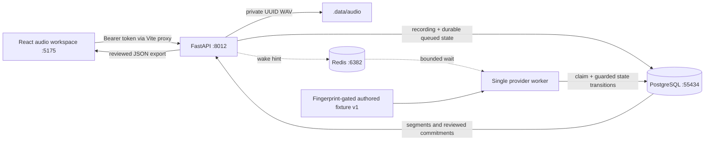

# Architecture — local workspace with optional live Gemini

`api/core.py` owns configuration, database connections, bounded WAV validation, local-token generation, and the small `fixture_for(fingerprint)` provider boundary. `api/main.py` owns HTTP contracts/upload/review/export. `api/providers.py` implements typed transcript/extraction contracts and the stateless Gemini Interactions adapter; `api/worker.py` owns phase transitions. `api/schema.sql` contains serialized, idempotent version-1/2 migrations (provider provenance and source quotations added in v2), serialized by a transaction advisory lock. PostgreSQL is authoritative; a lost Redis wakeup costs up to one second of polling latency, not a lost recording.

Each job advances `queued → transcribing → extracting → ready`, with cancellation and failure terminal states. Fixture jobs use two 1.2-second presentation pauses; these do not measure model latency. Live jobs run the two actual provider stages. A session advisory lock permits one local worker. On restart, interrupted fixture transcription/extraction returns to queued; interrupted live jobs become failed and require explicit retry, because their prior provider requests may already have completed. Completed reviews remain untouched. Row locks/state predicates ensure cancellation/deletion wins future phase transitions and commitment insertion commits atomically with ready. There is no automatic retry of terminal failures; explicit retry resets results on the existing recording, while load/upload creates a new recording. Crash recovery is at-least-once processing with guarded writes, not a distributed exactly-once claim.

Edits use a version counter for stale-editor conflicts and always scope item IDs to the recording ID. Actions require an owner when reviewed; a date may remain unspecified. Questions can be reviewed as open questions or explicitly changed to actions. JSON exports contain only persisted reviewed items, plus the source fingerprint and provider/version provenance. Library queries expose `limit` (1–100) and `offset`; the current UI intentionally loads only the latest 100 recordings.

The browser fetches authorized private audio into an object URL, derives a waveform from decoded PCM, and uses the same audio clock for segment selection. Fixture segment timing is derived from concatenated synthesized utterance lengths, including half-second gaps. Fixture speaker names are authored labels; both voices use Samantha. Live timestamps/speaker labels are model estimates, with no diarization acceptance claim.

## Implemented live path; acceptance pending

Every recording persists `provider=fixture|gemini`; fixture is the API default regardless of worker configuration. `CALLMAP_PROVIDER=gemini` plus a server-only key enables explicit per-upload opt-in. Load sample remains fixture-only. Live WAVs are capped at 10 MiB for base64 inline requests under the provider's 20 MB request cap. Exactly two requests are allowed per successful processing attempt: audio → typed timestamped transcript, then validated transcript → typed commitments. There are no tool calls, paid/model fallbacks, Files API uploads, redirects, or automatic HTTP retries. See [provider configuration and limits](live-provider.md).

Transcripts have consecutive IDs, bounded text/segment counts, finite ordered non-overlapping timestamps within measured WAV duration. Commitments link valid segment IDs and exact source quotations; named owners need exact actor-assignment evidence, and relative/ambiguous dates remain unresolved. English explicit month/day/year and ISO dates are checked deterministically. These checks enforce source traceability, not semantic truth; human review remains necessary. Read-only source quotations/date expressions are visible in the review UI and exports. Provenance stores model, API revision, prompt version, source hash, token counters and request durations for successful stages.

Cancellation/deletion is checked before each stage and guarded again at publication. Already in-flight provider requests cannot be recalled; cancellation suppresses result writes and prevents subsequent calls when observed. A manual retry can resend both stages and explicitly confirms external transmission. Provider failures expose sanitized messages and no raw provider response/key. Real speech/quality and a second provider are unvalidated; the evaluation harness records a blocked report until explicitly authorized with credentials.

## Retention and recovery

Audio, reviews, and jobs persist until explicit deletion. PostgreSQL and Redis have distinct project volumes; private audio resides in the checkout's ignored `.data`. Back up both the PostgreSQL database and audio directory together if needed. A file write happens before the recording transaction; a process kill in that short window can leave an orphan WAV. `scripts/prune_audio.py` lists orphan UUID WAVs by default; `--apply` deletes only listed orphans older than one hour. Run `.venv/bin/python -m scripts.prune_audio` (or add `--apply`) with API/worker stopped. There is no automatic retention, backup, retry scheduler, or production supervisor.
